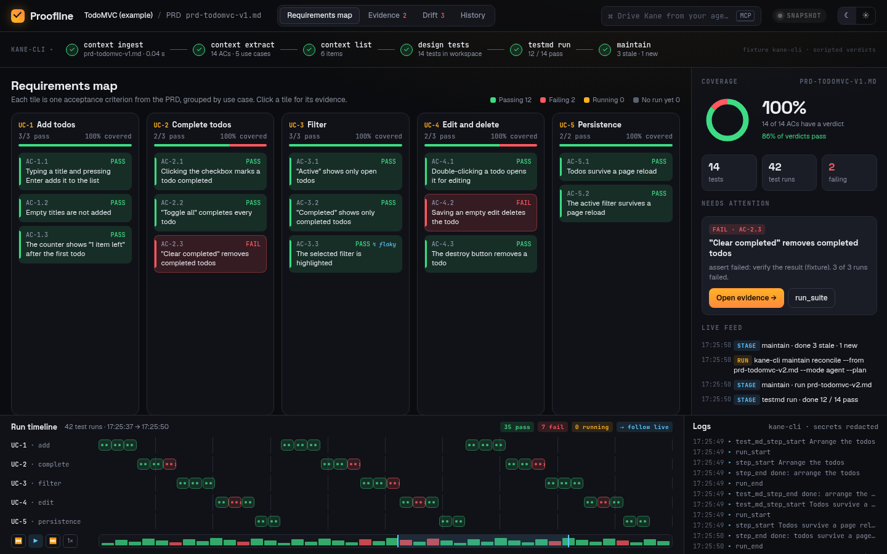

# Proofline

**Every requirement, proven live.** Proofline is a live verification dashboard and MCP server for
[Kane CLI](https://www.testmuai.com/support/docs/kane-cli-introduction/). Hand it a PRD and it drives
`kane-cli` through the whole loop: context, test design, `testmd` runs, evidence packs, and drift when
the PRD changes. Every acceptance criterion becomes a tile that turns green or red as Kane proves it,
with the screenshots, steps and logs behind each verdict one click away.



## 30-second quickstart

```bash
python3 -m proofline demo        # then open http://127.0.0.1:8777
```

The demo needs nothing but Python 3.10+. It runs the real Proofline pipeline against a **fixture**
stand-in for `kane-cli` (`proofline/fixtures/fake_kane.py`) that speaks Kane's documented agent-mode
output, so its verdicts are scripted and the dashboard labels them as fixture data. Use the steps below
for real runs.

## Setup for real Kane runs

```bash
npm install -g @testmuai/kane-cli
kane-cli login                    # OAuth profile; Proofline never sees or stores the token
python3 -m proofline status       # confirms kane-cli is found
python3 -m proofline serve        # dashboard on http://127.0.0.1:8777 (loopback only)
```

In a second terminal (or from your coding agent through MCP):

```bash
python3 -m proofline ingest examples/prd-todomvc-v1.md   # kane-cli context ingest
python3 -m proofline design uc-1 --max 3                 # kane-cli design tests
python3 -m proofline run --url https://demo.playwright.dev/todomvc   # kane-cli testmd run, every test
python3 -m proofline maintain examples/prd-todomvc-v2.md # PRD diff + kane-cli maintain reconcile --plan
python3 -m proofline manifest --out proof/manifest.json  # hashed artifact manifest
python3 -m proofline export site/                        # static report
```

Use-case extraction (`kane-cli context extract`) and design are conversational agent commands and spend
Kane credits; Proofline runs them in `--mode agent` so they never wait on a terminal.

## What you see

| View | What it shows |
| --- | --- |
| Pipeline strip | `context ingest → context extract → context list → design tests → testmd run → maintain`, live |
| Requirements map | one tile per AC, grouped by use case, with coverage ring and a needs-attention card |
| Timeline dock | every test run on a lane per use case, plus the streamed, redacted kane-cli log |
| Evidence | screenshots from the sealed evidence pack, steps, expected vs actual, the AC over time |
| Drift | word-level PRD diff, stale tests per changed AC, new ACs with no test, the `maintain` plan |
| History | pass rate and coverage per suite run, per-use-case sparklines, flip-floppers and flaky flags |

Dark by default with a light mode. Screenshots of every view are in [`docs/screenshots`](docs/screenshots).

## How it works

* **Run store** (`proofline/store.py`). SQLite with the same trace, score and settings contract as a
  general evaluation store, plus `sessions`, `runs`, `events`, `acs`, and an `artifacts` table that
  records every screenshot, evidence pack, log, test and PRD with its sha256 and creation time.
* **Kane adapter** (`proofline/adapter.py`). Turns `kane-cli` NDJSON (stream v1: `testmd run` typed
  events ending in `test_md_done`, `run` step lines ending in `run_end`, `context list --json` items)
  and sealed `.evidence` packs into traces. The AC id is the `case_id`; pass/fail is the `ac_pass` score.
* **Flaky detection.** An AC is flaky when its verdict flips at least twice while the test file and PRD
  fingerprint stay the same. A test that fails every run is a failure, not a flake.
* **Drift** (`proofline/drift.py`). Diffs PRD versions by AC id, marks tests that check changed or
  removed criteria as stale, and runs `kane-cli maintain reconcile --plan` so nothing changes without review.
* **Live stream.** `GET /api/stream` is Server-Sent Events fed from the durable event log, so a run
  started by the MCP server in another process appears on the dashboard as it happens.
* **Proof of work.** `export_manifest` writes `path, sha256, bytes, created_at, session_id` for every
  artifact, re-verifies each hash, and adds a hash over the whole manifest.

## MCP server

`python3 -m proofline mcp` is a stdio MCP server (JSON-RPC 2.0, no dependencies). Tools:

`proofline_status`, `ingest_prd`, `extract_context`, `list_context`, `design_tests`, `run_suite`,
`maintain_drift`, `get_run`, `get_evidence`, `list_acs`, `compare_runs`, `export_manifest`,
`export_dashboard`, `open_dashboard`.

Each tool shells out to `kane-cli`, writes its output and evidence into the run store stamped with the
creation time and session id, and streams progress to the dashboard. Replace `/path/to/proofline` below.

**Cursor**: `~/.cursor/mcp.json`

```json
{
  "mcpServers": {
    "proofline": {
      "command": "python3",
      "args": ["-m", "proofline", "mcp"],
      "cwd": "/path/to/proofline",
      "env": { "PROOFLINE_HOME": "/path/to/proofline/runs" }
    }
  }
}
```

**Codex**: `~/.codex/config.toml`

```toml
[mcp_servers.proofline]
command = "python3"
args = ["-m", "proofline", "mcp"]
cwd = "/path/to/proofline"
env = { PROOFLINE_HOME = "/path/to/proofline/runs" }
```

**Claude Code**: `~/.claude.json` (or `claude mcp add proofline -- python3 -m proofline mcp` from the repo)

```json
{
  "mcpServers": {
    "proofline": {
      "type": "stdio",
      "command": "python3",
      "args": ["-m", "proofline", "mcp"],
      "cwd": "/path/to/proofline",
      "env": { "PROOFLINE_HOME": "/path/to/proofline/runs" }
    }
  }
}
```

## Credentials and privacy

* Proofline has no credential settings. `kane-cli login` keeps its own profile.
* If `KANE_USERNAME` and `KANE_ACCESS_KEY` (or `LT_USERNAME` / `LT_ACCESS_KEY`) are set, they are passed
  to the `kane-cli` commands that accept basic auth. Their values, bearer tokens, JWTs, emails and home
  paths are redacted from every log, event and export. Note that basic-auth flags are visible to other
  local processes while a run is active; the OAuth profile avoids that.
* The server binds to `127.0.0.1` only, and `/artifacts/` serves files inside the run store only.
* `runs/`, `.env`, evidence packs and the database are git-ignored.

## Tests

```bash
python3 -m unittest discover -s tests -t .
```

Covers the adapter (both stream shapes, `context list --json`, evidence packs and zip-path safety),
PRD parsing and drift, redaction, the full pipeline with flaky detection and manifest verification,
the HTTP server and SSE stream, static export, and an MCP round-trip over real stdio.

## License

MIT © 2026 Mackenzie O'Brien
